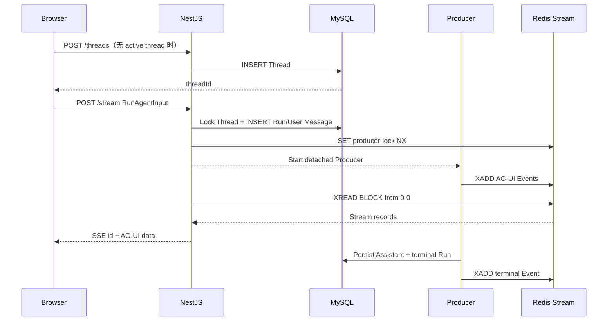
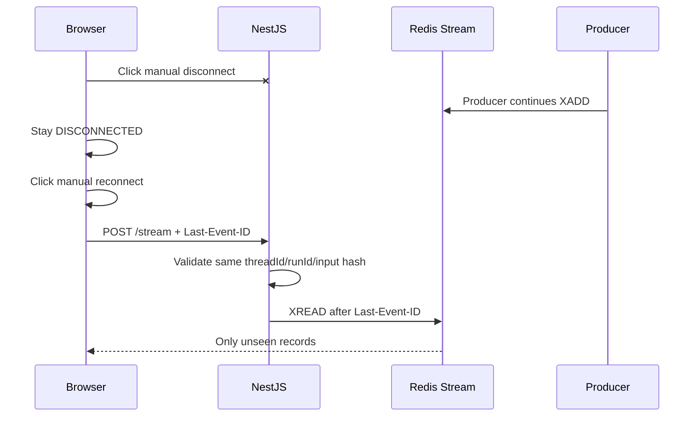
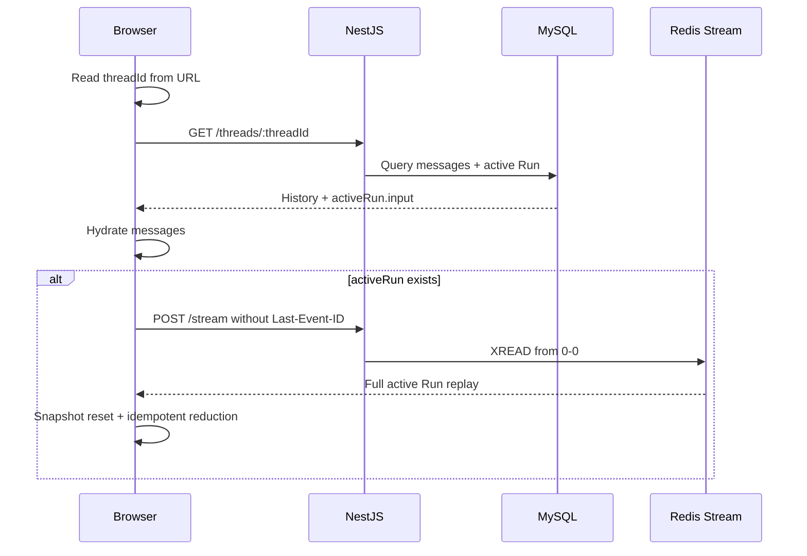

# Agent Stream Recovery Technical Design

## 1. 设计目标

本 Lab 验证的是生产 Agent 应用中的传输可靠性，而不是生成内容本身。

系统必须同时满足：

- Agent Producer 与浏览器 SSE Consumer 解耦。
- 同一个 Run 可以被重复连接，但只能启动一个 Producer。
- 页面内断线从最后确认的 Redis Stream ID 继续。
- 页面刷新或跨页面恢复不依赖客户端持久化游标。
- 历史消息、Run 状态和活跃事件分别使用合适的持久化介质。
- 前端以 at-least-once 语义消费事件，Reducer 必须幂等。
- 传输结束不等于 Run 正常结束，只有 AG-UI 终态事件可以结束运行态。

只有 `SimulatedAgentProducer` 是模拟实现。前后端 HTTP、SSE、AG-UI、MySQL、Redis Stream、锁、终止、
恢复和测试均按真实生产链路实现。

## 2. 协议与依赖决策

### 2.1 AG-UI

使用稳定版 `@ag-ui/core@0.0.57` 并精确锁定版本，不使用 canary。

原因：

- `RunAgentInput` 原生定义 `threadId`、`runId`、`messages`、`state`、`tools`、`context` 和
  `forwardedProps`。
- 标准 Event 已覆盖 Run、Message、Tool Call 和 Snapshot 生命周期。
- 当前协议仍处于 `0.x`，使用范围版本会让协议结构在普通安装中不可控地变化。

`packages/shared-types` 依赖并重新导出所需 AG-UI 类型和运行时 Schema，前后端不重复声明协议类型。

本 Lab 不使用 `@ag-ui/client` 的默认 `HttpAgent`。断点游标、异常 EOF、故障注入和重连状态机正是实验需要
显式展示的核心能力，隐藏在默认 Client 内会削弱可观察性和可测试性。

### 2.2 HTTP + SSE

- 新运行、重复订阅、页面内重连和刷新恢复统一使用 `POST /api/stream`。
- 请求体始终是 AG-UI `RunAgentInput`。
- Redis Stream ID 通过标准 SSE `id:` 字段发送。
- 页面内重连通过标准 `Last-Event-ID` 请求头传递游标。
- AG-UI JSON 保持原始结构，不增加 `streamEventId` 等传输字段。
- 每 10 秒无业务事件时发送 SSE 注释心跳。

原生 `EventSource` 不支持 POST Body 和本 Lab 需要的自定义请求控制，因此使用 `fetch`、
`ReadableStream` 和公共 SSE Parser。

### 2.3 Redis Stream

Redis Stream 同时提供：

- 有序事件 ID。
- 断点后的增量读取。
- 从 `0-0` 开始的完整 Run 重放。
- 多个 Consumer 独立读取同一条事件流。

不使用 Redis Pub/Sub，因为断线期间的消息无法补发；不使用 Consumer Group，因为每个浏览器都需要看到
同一 Run 的完整事件，而不是在消费者间分摊事件。

### 2.4 MySQL

MySQL 保存 Thread、紧凑 Message 和 Run 审计状态。流式 delta 不逐条写 MySQL，避免高频写放大。

活跃 Run 的增量内容保存在 Redis Stream；Run 到达终态时，将最终或中断后的 Assistant Message
一次性持久化到 MySQL。

## 3. 系统边界

```text
Browser
  ├── Thread REST Service ────────────────┐
  └── AG-UI POST SSE Service ────────────┤
                                         ▼
NestJS
  ├── ThreadsModule ───────────────► MySQL
  └── AgentStreamModule
      ├── RunCoordinator ──────────► MySQL
      ├── SimulatedAgentProducer
      └── RunEventStream ──────────► Redis DB 1
                                         │
                                         └── XREAD BLOCK ──► SSE Consumer
```

依赖方向：

```text
Controller
  → Application Service
    → Producer Port / PrismaService / RunEventStreamService
      → RedisService
```

Controller 只负责 DTO、Header、HTTP 状态和 SSE Frame 写入。Producer 不持有 HTTP Response，浏览器断开不会
取消 Producer。

## 4. 目录设计

```text
packages/shared-types/src/
├── agent-stream.ts
└── index.ts

apps/web/src/
├── app/labs/(detail)/agent-stream-recovery/
│   └── page.tsx
├── services/
│   ├── base-request.ts
│   ├── base-sse.ts
│   ├── agent-stream.ts
│   └── threads.ts
└── labs/agent-stream-recovery/
    ├── components/
    │   ├── agent-stream-recovery-lab/index.tsx
    │   ├── connection-inspector/index.tsx
    │   ├── event-log/index.tsx
    │   ├── fault-controls/index.tsx
    │   ├── message-list/index.tsx
    │   ├── prompt-composer/index.tsx
    │   └── thread-history/index.tsx
    ├── core/
    │   ├── ag-ui-event-reducer.ts
    │   ├── reconnect-policy.ts
    │   └── stream-state-machine.ts
    ├── hooks/
    │   └── use-agent-stream-lab.ts
    └── store/
        ├── runtime.ts
        └── thread.ts

apps/server/
├── prisma/
│   ├── schema.prisma
│   └── migrations/<timestamp>_agent_stream_recovery/migration.sql
└── src/modules/
    ├── threads/
    │   ├── dto/
    │   ├── __tests__/
    │   ├── threads.controller.ts
    │   ├── threads.service.ts
    │   └── threads.module.ts
    └── agent-stream/
        ├── dto/
        ├── __tests__/
        ├── agent-producer.port.ts
        ├── agent-stream.controller.ts
        ├── agent-stream.module.ts
        ├── agent-stream.service.ts
        ├── run-coordinator.service.ts
        ├── run-event-stream.service.ts
        ├── simulated-agent-producer.service.ts
        └── sse-encoder.ts
```

路由文件只接入 `AgentStreamRecoveryLab`，不得放入 Store、请求或事件处理逻辑。

## 5. API 设计

### 5.1 创建 Thread

```http
POST /api/threads
Content-Type: application/json
```

```json
{
  "title": "可选标题"
}
```

返回 HTTP 201：

```json
{
  "id": "019...",
  "title": "可选标题",
  "createdAt": "2026-07-23T08:00:00.000Z",
  "updatedAt": "2026-07-23T08:00:00.000Z",
  "activeRun": null
}
```

如果用户直接发送第一条消息，前端先创建 Thread；未输入标题时，服务端用用户文本的前 40 个字符更新标题。

### 5.2 Thread 列表

```http
GET /api/threads?limit=30&cursor=<opaque>
```

返回按 `updatedAt DESC, id DESC` 排序的游标分页结果。每个 Summary 包含 `activeRun`，用于历史列表展示运行中
状态，但不包含完整 `input`。

### 5.3 Thread 详情

```http
GET /api/threads/:threadId
```

```ts
interface ThreadDetail {
  id: string;
  title: string | null;
  createdAt: string;
  updatedAt: string;
  messages: ThreadMessage[];
  activeRun: {
    runId: string;
    status: 'PENDING' | 'RUNNING' | 'CANCELLING';
    startedAt: string | null;
    input: RunAgentInput;
  } | null;
}
```

`activeRun` 是唯一恢复依据。前端不得通过最后一条消息推导 `runId`。

### 5.4 删除 Thread

```http
DELETE /api/threads/:threadId
```

- 无活跃 Run：删除指定 Thread，由外键级联删除 Message 和 Run，返回 HTTP 204。
- 存在活跃 Run：返回 HTTP 409 `THREAD_HAS_ACTIVE_RUN`。

该接口用于正常产品能力和 E2E 精确清理，不允许批量或无条件清库。

### 5.5 创建或订阅 Run

```http
POST /api/stream
Accept: text/event-stream
Content-Type: application/json
Last-Event-ID: 1721234567890-0
```

请求体：

```ts
interface LabRunAgentInput extends RunAgentInput {
  state: Record<string, never>;
  tools: [];
  context: [];
  forwardedProps: {
    simulation?: {
      failAfterChunks?: number;
    };
  };
}
```

第一次收到 `runId`：

1. 校验 Thread、完整 Input 和最后一条 User Message。
2. 规范化 Input 并计算 SHA-256。
3. 在事务中锁定 Thread 行，确认 Thread 没有其他活跃 Run。
4. 创建 Run 并持久化 User Message。
5. 获取 Producer 分布式锁并异步启动 Producer。
6. 当前 HTTP Consumer 从 Redis Stream 读取事件。

再次收到相同 `runId`：

- `threadId` 和 Input Hash 相同：只附加 Consumer。
- Thread 或 Input 不同：HTTP 409 `RUN_INPUT_CONFLICT`。
- 不会启动第二个 Producer。

无 `Last-Event-ID` 时从 `0-0` 读取；有游标时只读取游标之后的事件。

### 5.6 终止 Run

```http
POST /api/stream/abort
Content-Type: application/json
```

```json
{
  "threadId": "019...",
  "runId": "019..."
}
```

返回 HTTP 202。重复终止是幂等操作。

服务端将 Run 更新为 `CANCELLING` 并写入 Redis Abort Key。Producer 收到信号后：

1. 结束已开始的 Message。
2. 持久化非空的中断内容。
3. 将 Run 更新为 `ABORTED`。
4. 发送 `RUN_FINISHED`，`result.status` 为 `aborted`。

如果服务进程曾退出，数据库中可能存在没有存活 Producer 的 `CANCELLING` 孤儿 Run。Abort 接口给协作式取消
保留一个有界的服务端宽限期；宽限期后使用带活跃状态条件的数据库更新强制收敛为 `ABORTED`，再通过 Redis
Terminal Marker 幂等补发唯一终态。Producer 与兜底路径发生竞争时，以数据库已经持久化的终态构造事件，
不能直接使用 Producer 的本地返回值覆盖它。

前端保留 SSE 连接等待终态，5 秒宽限时间后才强制关闭本地连接。

## 6. AG-UI 事件序列

默认序列包含 Tool Call：

```text
RUN_STARTED
MESSAGES_SNAPSHOT
TEXT_MESSAGE_START
TEXT_MESSAGE_CONTENT
TOOL_CALL_START
TOOL_CALL_ARGS × N
TOOL_CALL_END
TOOL_CALL_RESULT
TEXT_MESSAGE_CONTENT
TEXT_MESSAGE_END
RUN_FINISHED
```

Producer 异常：

```text
...已产生的 Message/Tool 事件
TEXT_MESSAGE_END（仅在已经 Start 时）
RUN_ERROR
```

规则：

- `RUN_STARTED` 必须是首个业务事件。
- `MESSAGES_SNAPSHOT` 使用 Run 创建时保存的 Input Snapshot。
- Message 和 Tool Call 使用 Start → Content/Args → End。
- `RUN_FINISHED` 或 `RUN_ERROR` 是唯一正常传输终态。
- 每条事件先 XADD 到 Redis Stream，SSE Consumer 只读取 Redis，不直接消费 Producer 内存回调。

SSE Frame：

```text
id: 1721234567890-0
data: {"type":"TEXT_MESSAGE_CONTENT","messageId":"019...","delta":"hello"}

```

心跳：

```text
: heartbeat

```

## 7. 数据模型

### 7.1 `t_threads`

| 字段         | 类型           | 约束                      | 说明         |
| ------------ | -------------- | ------------------------- | ------------ |
| `id`         | `CHAR(36)`     | PK                        | UUIDv7       |
| `title`      | `VARCHAR(120)` | NULL                      | Thread 标题  |
| `created_at` | `DATETIME(3)`  | NOT NULL, DEFAULT CURRENT | UTC 创建时间 |
| `updated_at` | `DATETIME(3)`  | NOT NULL                  | UTC 更新时间 |

索引：

- `idx_threads_updated_at_id(updated_at, id)`

### 7.2 `t_agent_runs`

| 字段             | 类型           | 约束                      | 说明                 |
| ---------------- | -------------- | ------------------------- | -------------------- |
| `id`             | `CHAR(36)`     | PK                        | AG-UI `runId`        |
| `thread_id`      | `CHAR(36)`     | FK, NOT NULL              | 所属 Thread          |
| `input_hash`     | `CHAR(64)`     | NOT NULL                  | 规范化 Input SHA-256 |
| `input_snapshot` | `JSON`         | NOT NULL                  | 原始 `RunAgentInput` |
| `status`         | `VARCHAR(24)`  | NOT NULL                  | Run 状态             |
| `error_code`     | `VARCHAR(64)`  | NULL                      | 稳定错误码           |
| `error_message`  | `VARCHAR(512)` | NULL                      | 脱敏错误信息         |
| `started_at`     | `DATETIME(3)`  | NULL                      | Producer 启动时间    |
| `finished_at`    | `DATETIME(3)`  | NULL                      | 终态时间             |
| `created_at`     | `DATETIME(3)`  | NOT NULL, DEFAULT CURRENT | 创建时间             |
| `updated_at`     | `DATETIME(3)`  | NOT NULL                  | 更新时间             |

索引与外键：

- `thread_id → t_threads.id ON DELETE CASCADE`
- `idx_agent_runs_thread_status_created(thread_id, status, created_at)`
- `idx_agent_runs_status_updated(status, updated_at)`

状态：

```text
PENDING → RUNNING → SUCCEEDED
                  → FAILED
                  → CANCELLING → ABORTED
```

不使用 Prisma Enum；状态常量和联合类型定义在 `shared-types`。

### 7.3 `t_messages`

| 字段         | 类型          | 约束                      | 说明                        |
| ------------ | ------------- | ------------------------- | --------------------------- |
| `id`         | `CHAR(36)`    | PK                        | AG-UI `messageId`           |
| `thread_id`  | `CHAR(36)`    | FK, NOT NULL              | 所属 Thread                 |
| `run_id`     | `CHAR(36)`    | FK, NOT NULL              | 产生或触发该消息的 Run      |
| `role`       | `VARCHAR(20)` | NOT NULL                  | AG-UI Message Role          |
| `payload`    | `JSON`        | NOT NULL                  | 紧凑后的完整 AG-UI Message  |
| `status`     | `VARCHAR(24)` | NOT NULL                  | `COMPLETED` / `INTERRUPTED` |
| `created_at` | `DATETIME(3)` | NOT NULL, DEFAULT CURRENT | 创建时间                    |
| `updated_at` | `DATETIME(3)` | NOT NULL                  | 更新时间                    |

索引与外键：

- `thread_id → t_threads.id ON DELETE CASCADE`
- `run_id → t_agent_runs.id ON DELETE CASCADE`
- `idx_messages_thread_created_id(thread_id, created_at, id)`
- `idx_messages_run_created(run_id, created_at)`

`payload` 是消息内容的唯一事实来源，能够保存 Assistant Tool Calls 和 Tool Result，避免未来扩展 AG-UI
消息类型时修改表结构。`role` 作为冗余受控字段用于筛选和数据校验，写入时必须与 `payload.role` 一致。

### 7.4 并发约束

MySQL 不提供适合本场景的部分唯一索引。创建 Run 时在事务内对目标 Thread 执行行锁，再检查活跃状态，保证同一
Thread 同时只有一个 `PENDING/RUNNING/CANCELLING` Run。

`runId` 主键和 `input_hash` 共同实现请求幂等与碰撞检测。

## 8. Redis 设计

node-redis 已配置 `frontend-study:` 自动前缀。以下均为传给 Client 的逻辑 Key：

| Key                                            | 类型   | TTL/限制          | 用途                    |
| ---------------------------------------------- | ------ | ----------------- | ----------------------- |
| `agent-stream:runs:{runId}:events`             | Stream | 终态后 30 分钟    | AG-UI Event Log         |
| `agent-stream:runs:{runId}:producer-lock`      | String | 30 秒，10 秒续租  | 单 Producer 分布式锁    |
| `agent-stream:runs:{runId}:abort`              | String | 10 分钟           | 幂等终止信号            |
| `agent-stream:runs:{runId}:runtime`            | Hash   | 活跃期滚动 1 小时 | 状态与 Producer 心跳    |
| `agent-stream:runs:{runId}:terminal-published` | String | 30 分钟           | 终态 Event 补偿幂等标记 |

Stream 行为：

- `XADD MAXLEN ~ 10000` 控制单 Run 最大事件数。
- `XREAD BLOCK 10000 COUNT 100` 批量拉取。
- 每个 SSE Consumer 使用独立 duplicate connection，避免阻塞主 Redis Client。
- 每次写事件延长活跃期 TTL。
- Run 到达终态后统一设置 30 分钟 TTL。
- 不创建 Consumer Group。

Producer Lock 使用随机 Token。续租和释放必须通过比较 Token 的 Lua 脚本完成，避免旧持有者删除新锁。

禁止使用模糊 Key 删除；清理只针对已解析并校验的具体 `runId`。

## 9. Producer 与一致性

### 9.1 可替换端口

```ts
interface AgentProducer {
  run(input: RunAgentInput, context: ProducerContext): Promise<void>;
}
```

`SimulatedAgentProducer` 是第一个 Adapter。未来接入真实 Agent 时替换 Provider，不改 Controller、Redis
Stream、恢复协议或前端状态机。

### 9.2 模拟行为

- 根据最后一条纯文本 User Message 生成不少于原短回复 5 倍的结构化长回复。
- 文本增量由服务端每 20ms 生成并入队一次，每片随机为 2～12 个 Unicode 字符。
- Redis Append 按调用顺序并发排队，Producer 在返回结果前统一等待全部 ACK；远程 RTT 不串行叠加到每个分片。
- Abort Signal 每 10 个 Chunk 检查一次，在停止响应速度和远程 Redis 压力之间保持有界平衡。
- Tool Call 是每次 Run 的默认协议节点，只模拟协议事件，不执行外部副作用。
- `forwardedProps.simulation` 只允许带服务端上下界的失败点，前端不能控制节奏或 Tool Call。
- 可选失败点用于验证 `RUN_ERROR`。

### 9.3 MySQL 与 Redis 终态补偿

MySQL 与 Redis 无法做跨存储事务，采用可补偿顺序：

1. Producer 将非终态事件写入 Redis。
2. 在 MySQL 事务中保存 Assistant Message 并更新 Run 终态。
3. 通过 `terminal-published` 幂等标记写入终态 AG-UI Event。
4. SSE Consumer 读取终态并自然结束。

若步骤 3 失败，后续 Attach 发现 MySQL 已是终态但 Stream 缺少终态时，补发同语义终态 Event。前端按 SSE
ID 和业务实体 ID 幂等处理。

本 Lab 不承诺 NestJS 进程崩溃后继续执行同一个模拟 Producer；该能力需要任务队列或可恢复 Agent
Checkpoint，属于后续独立 Lab。浏览器断开、刷新和多 Consumer 不受此限制。

## 10. 前端公共请求层

### 10.1 `base-request.ts`

保留 magic-book 的通用能力：

- Query 参数序列化。
- JSON、String、Blob、FormData Body。
- `credentials: include`。
- JSON 响应解包。
- 统一结构化 HTTP Error。
- GET、POST、PUT、PATCH、DELETE 快捷方法。

调整：

- 删除 `systemStore`、`uname` 和任何企业身份逻辑。
- 通用请求层不直接依赖具体 Lab Store。
- 超时必须 Abort 实际 fetch，并在完成后清理 Timer。
- 合并调用方 Signal 与 Timeout Signal。
- 只把 2xx 视为成功。
- Error 保留 `status`、稳定 `code`、`body` 和 `retryable`。

### 10.2 `base-sse.ts`

职责仅限 HTTP SSE Transport：

- POST Body、Headers 和 AbortSignal。
- 校验 2xx 和 `text/event-stream`。
- 增量 `TextDecoder`，结束时 flush Decoder。
- 正确处理 `\n`、`\r\n`、分片边界、UTF-8 半字符。
- 支持 `id`、`event`、`retry`、多行 `data` 和注释心跳。
- 返回 `{ id, event, data }`，不读取 AG-UI 私有字段。
- 区分 HTTP Error、协议错误、网络错误、本地 Abort 和普通 EOF。
- 设置最大单 Event Buffer，避免异常流造成无限内存增长。

AG-UI 终态判断、重连和 Store 更新不放在公共 Parser 内，由 `agent-stream.ts` 和 Lab 状态机处理。

## 11. 前端状态模型

### 11.1 Thread Store

保存可序列化数据：

```ts
interface ThreadState {
  activeThreadId: string | null;
  threadsById: Record<string, ThreadSummary>;
  messagesByThreadId: Record<string, ChatMessage[]>;
  listStatus: 'idle' | 'loading' | 'ready' | 'error';
  detailStatusByThreadId: Record<string, LoadStatus>;
}
```

不使用 Zustand Persist。当前 Thread 由 URL `?threadId=<uuid>` 表达。

### 11.2 Runtime Store

按 Thread 分桶：

```ts
interface RunRuntime {
  runId: string | null;
  phase: ConnectionPhase;
  lastEventId: string | null;
  reconnectAttempt: number;
  duplicateEvents: number;
  terminalEventReceived: boolean;
  abortRequested: boolean;
  error: StreamError | null;
}
```

`AbortController`、Timer 和 Reader 不进入 Zustand；这些非序列化资源由 Session 对象持有。

### 11.3 Connection State Machine

```text
IDLE
  └── SUBMIT / RESTORE_ACTIVE_RUN
        ▼
CONNECTING
  ├── HTTP_SSE_READY ──► STREAMING
  ├── RETRYABLE_ERROR ─► RECONNECT_WAIT
  └── FATAL_ERROR ─────► FAILED

STREAMING
  ├── RUN_FINISHED ────► COMPLETED / ABORTED
  ├── RUN_ERROR ───────► FAILED
  ├── RETRYABLE_ERROR ─► RECONNECT_WAIT
  ├── EOF_NO_TERMINAL ─► RECONNECT_WAIT
  └── MANUAL_DISCONNECT ► DISCONNECTED

DISCONNECTED
  └── MANUAL_RECONNECT ─► CONNECTING

RECONNECT_WAIT
  ├── TIMER ───────────► CONNECTING
  ├── USER_RETRY ──────► CONNECTING
  └── ABORT ───────────► ABORTING
```

默认最多自动重连 5 次，采用带抖动的指数退避：

```text
300ms → 600ms → 1200ms → 2400ms → 5000ms
```

错误分类：

| 场景                          | 自动重试 | 行为                            |
| ----------------------------- | -------- | ------------------------------- |
| 网络错误、5xx、429、408       | 是       | 保留内存游标重连                |
| EOF 且没有 AG-UI 终态         | 是       | 视为异常断线                    |
| 用户点击“模拟断线”            | 否       | 停留在断线态，等待“模拟重连”    |
| 400、404、409、协议 JSON 非法 | 否       | 展示明确错误                    |
| Stream 游标已过期             | 条件式   | 重新拉详情，活跃时从 `0-0` 重建 |
| 用户主动停止                  | 否       | 等待服务端终态                  |
| Thread 切换或组件卸载         | 否       | 仅关闭 Consumer，Producer 继续  |

### 11.4 AG-UI Reducer

Reducer 输入：

```ts
interface ReceivedAgUiEvent {
  streamId: string;
  event: BaseEvent;
}
```

规则：

- 先按 `streamId` 去重，同一个 SSE Event 最多应用一次。
- `MESSAGES_SNAPSHOT` 建立确定性基线，解决历史详情和完整重放的交叠。
- `TEXT_MESSAGE_START` 按 `messageId` Upsert。
- `TEXT_MESSAGE_CONTENT` 只对未见过的 Stream ID 追加 delta。
- `TEXT_MESSAGE_END` 只更新 Message 状态，不复制内容。
- Tool Call 按 `toolCallId` Upsert 并顺序拼接 Args。
- Content 早于 Start 时创建占位实体，随后由 Start 补全，保证对异常顺序有韧性。
- 已处理 Stream ID 使用有界 LRU Set，避免长时间会话无限增长。
- Protocol Event Log 最多保留最近 200 条用于观察，不作为消息真源。
- 只有 AG-UI Event 完成校验并被 Reducer 成功应用后，才更新内存中的 `lastEventId`，避免先推进游标再更新
  UI 导致事件丢失。

## 12. 恢复数据流

### 12.1 新运行



### 12.2 页面内断线



### 12.3 页面刷新



localStorage 和 sessionStorage 不参与以上流程。

## 13. 页面与交互设计

布局树：

```text
AgentStreamRecoveryLab
├── Lab Header
│   ├── 标题与实验说明
│   └── New Thread / History / Disconnect / Retry
├── Workspace
│   ├── Chat Panel
│   │   ├── Active Thread Toolbar
│   │   ├── Message Timeline
│   │   ├── Loading / Error / Empty
│   │   └── Prompt Composer + Stop
│   └── Inspector
│       ├── Runtime：threadId/runId/phase/cursor/retry
│       ├── Faults：Producer Failure
│       └── Events：最近 AG-UI Event Log
└── Thread History Sheet
    ├── Thread List
    ├── Running Badge
    └── Delete Action
```

桌面端 Chat 和 Inspector 双列展示；窄屏下 Inspector 移到 Chat 下方，Thread History 使用 Sheet。Lab 详情页
直接占用完整视口，不展示平台侧边栏或移动端模块导航。

Chat Panel 使用受视口约束的固定工作区高度。Thread Toolbar 和 Prompt Composer 为不可收缩区域，只有中间的
Message Timeline 使用 `min-height: 0` 与独立 ScrollArea 滚动。消息追加时仅在用户仍停留于底部附近时自动跟随；
用户主动向上阅读历史后，不得被后续增量强制拉回底部。

空会话不渲染引导卡片，Message Timeline 保持纯空白。Prompt Composer 在面板底部使用居中的最大宽度容器，
字数统计位于输入框左下角，发送、停止和连接中状态复用右下角的纯图标按钮位置。

Inspector 在桌面端建立 `Card → Tabs → TabsContent → ScrollArea` 的完整高度链。Tab List 固定在顶部，Event
TabPanel 撑满剩余空间，只有 Event Log 内部滚动；Connection 与 Fault 内容保持顶部对齐。

状态设计：

- Empty：解释实验目标并引导输入第一条消息。
- Loading：历史详情使用 Skeleton；连接使用独立状态 Badge。
- Error：显示稳定错误码、可重试动作，不输出底层连接信息。
- Streaming：Assistant Message 显示流式光标，Stop 可用。
- Reconnecting：保留已渲染消息，展示倒计时与重连次数。
- Aborted/Failed：消息卡和 Runtime 面板同时展示终态。

## 14. 安全与资源边界

- Thread、Run、Message ID 必须是 UUIDv7。
- 用户纯文本去除首尾空白，长度限制 1～4000 字符。
- Thread 标题长度不超过 120 字符。
- Simulation 参数严格白名单和数值上下界。
- 不记录完整 Prompt、Cookie、数据库连接或 Redis 凭据。
- Error Response 不返回 Stack。
- 单 SSE Event Buffer、Event Log、Stream 长度和自动重试次数都有上限。
- 当前仓库没有身份系统，本 Lab 不伪造用户鉴权或租户隔离；部署到公网前必须增加 Thread Owner 校验。

## 15. 测试方案

### 15.1 前端单元测试

- SSE 在任意 Byte 边界拆分，包含 UTF-8 半字符。
- CRLF、连续注释、空字段、多行 data、id 和结束 Buffer。
- 非 SSE Content-Type、非法 JSON、超大 Buffer、Abort 和 EOF。
- AG-UI Snapshot、Text、Tool、Terminal Reducer。
- 重复 Stream ID、乱序 Start/Content、从 `0-0` 重放。
- 网络错误、异常 EOF、退避、重试上限和主动停止状态机。
- Zustand Selector、Thread 切换和历史 Hydrate。

### 15.2 后端单元测试

- DTO 与 Simulation 参数边界。
- Input 规范化与 Hash 稳定性。
- 首次 Run、重复 Attach、Input 冲突和 Thread Busy。
- Producer Lock Token 续租与安全释放。
- Stream 读取游标、批量读取、TTL 和终态补偿。
- Producer 标准事件顺序、Tool Call、失败和终止。
- Thread 详情只从 Run 表生成 `activeRun`。

测试使用 Fake/Mock，不访问私人 MySQL 或 Redis。

### 15.3 Playwright

CI 使用现有隔离 MySQL 8.4 和 Redis 服务，并先执行受控 Migration。

覆盖：

1. 新建 Thread → 流式完成 → 刷新读取历史。
2. 生成中模拟断开 Consumer → 保持断线 → 用户点击重连 → 从游标继续且无重复文本。
3. 生成中刷新页面 → 历史接口判断 activeRun → 从 `0-0` 重放。
4. 主动停止 → 收到终态 → 不自动重连。
5. Producer 故障 → 展示 `RUN_ERROR`。
6. E2E 只删除自身创建的 Thread，不执行批量清理。

## 16. 实施顺序

1. 增加 AG-UI 和共享 API 类型。
2. 实现并测试公共 `base-request`、`base-sse`。
3. 增加 Prisma Schema、受控 SQL Migration 和 CI Migration。
4. 实现 ThreadsModule。
5. 扩展 RedisService，支持 Stream 和阻塞读取连接。
6. 实现 RunEventStream、Producer Lock 和 RunCoordinator。
7. 实现 SimulatedAgentProducer、`/stream` 和 `/stream/abort`。
8. 实现前端 Reducer、状态机、Store 和 Services。
9. 实现 Lab 页面、Inspector 和故障注入。
10. 补齐单测、Playwright、架构、API、技术决策和用户文档。

## 17. 方案边界与后续演进

本次包含：

- 浏览器级断线、刷新、重复 Consumer、重复请求、Abort 和 Producer Error。
- 单实例或多实例 NestJS 下的单 Producer 锁和 Redis 共享事件。

本次不包含：

- 真实 LLM/Agent SDK。
- NestJS 进程崩溃后的 Producer Checkpoint 恢复。
- 用户鉴权和多租户。
- 长期保存每条原始 Stream Event。
- WebSocket、HTTP Binary、Human-in-the-loop 和多模态输入。

这些边界不会阻塞未来替换真实 Agent Producer，也不会改变前端恢复协议。

## 18. 参考

- [AG-UI Core Types](https://docs.ag-ui.com/sdk/js/core/types)
- [AG-UI Events](https://docs.ag-ui.com/concepts/events)
- [AG-UI Architecture](https://docs.ag-ui.com/concepts/architecture)
- [AG-UI Serialization](https://docs.ag-ui.com/concepts/serialization)
- [AG-UI GitHub](https://github.com/ag-ui-protocol/ag-ui)
